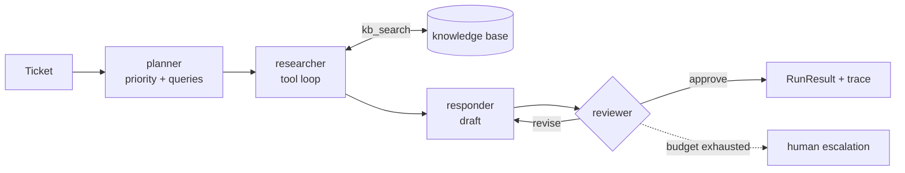

# orchestra

[](https://github.com/2jason986/multi-agent-orchestrator/actions/workflows/ci.yml)
[](https://www.python.org/downloads/)
[](LICENSE)

A multi-agent orchestrator for support tickets, written against the Python standard
library only. Four specialised agents — planner, researcher, responder, reviewer —
cooperate on one task, and every run leaves a trace you can read.

[中文说明](README.zh-CN.md)

```bash
git clone https://github.com/2jason986/multi-agent-orchestrator.git
cd multi-agent-orchestrator
python -m orchestra.cli demo        # no API key, no network, no dependencies
```

## What it does

A ticket arrives. The pipeline decides how urgent it is, retrieves grounded
evidence from an internal knowledge base, drafts a customer reply, and refuses to
let that reply leave the building until a reviewer agent signs off — or until the
revision budget runs out, in which case the ticket is escalated to a human.

That last part matters more than it sounds. A single prompt that "answers tickets"
is a demo. A pipeline with a veto step, a bounded revision loop and an audit trail
is something you can put in front of customers.

## Architecture



| Role | Responsibility | Output contract |
|---|---|---|
| `planner` | Classify the request, choose search queries, lay out a plan | `{"priority", "queries", "plan", "subject"}` |
| `researcher` | Call `kb_search` until it has evidence, summarise it with citations | `{"summary", "citations"}` |
| `responder` | Write the customer-facing reply from those notes only | `{"draft", "citations"}` |
| `reviewer` | Veto power: traceability, no invented policy, one concrete next step | `{"verdict", "feedback"}` |

Agents never call each other. The orchestrator owns the data flow, so the control
flow stays linear and testable, and swapping one role for a different model is a
one-line change.

## Demo output

`python -m orchestra.cli demo` on the three bundled tickets:

```
provider      : mock
tickets       : 3
approved      : 3
needs a human : 0
review rounds : 6
report        : examples/output/report.md
```

It writes three files: `report.md` (reply plus trace per ticket), `traces.json`
(machine-readable events) and `tickets.json` (the ticket store after the run, so
the status change from `open` to `answered` is visible).

One ticket's reply and part of its trace:

```markdown
## T-1001 · 数据导出任务一直卡在 90%

- priority: **normal**
- review rounds: 2 (approved)
- citations: `kb-export`

### Reply

您好，关于「数据导出任务一直卡在 90%」：

· [kb-export] 数据导出：判断任务是否还在跑，看「设置 → 数据导出 → 任务列表」里的状态字段：
  running 表示仍在处理，failed 才需要重新提交。

另外，麻烦您补充一下出现问题时使用的账号和环境信息，方便我们进一步定位。
如果以上信息没有解决您的问题，请直接回复本邮件，我们会安排工程师跟进。
```

```markdown
| # | offset (ms) | event | actor | summary |
|---|---|---|---|---|
| 5 | 2 | `tool.call` | kb_search | ok: 数据导出任务一直卡在 |
| 9 | 2 | `agent.start` | reviewer | review round 1 |
| 10 | 2 | `agent.end` | reviewer | verdict=revise |
| 14 | 2 | `agent.end` | reviewer | verdict=approve |
```

The first review round rejects the draft, the responder revises it, the second
round approves. That loop is the point of the project, not an accident.

## Using a real model

The default provider is `mock`: a scripted, deterministic client that exercises the
whole pipeline offline. Point it at any OpenAI-compatible endpoint — OpenAI,
DeepSeek, Moonshot, Qwen, vLLM, Ollama — by setting three environment variables:

```bash
export ORCHESTRA_API_KEY=sk-...
export ORCHESTRA_BASE_URL=https://api.deepseek.com/v1
export ORCHESTRA_MODEL=deepseek-chat

python -m orchestra.cli --provider openai --model deepseek-chat demo
```

No SDK is installed; the client talks to `/chat/completions` with `urllib`. If you
prefer a different vendor, implement the four-line `LLMClient` protocol and pass
your object to `Orchestrator`.

## Project layout

```
src/orchestra/
  llm.py            LLMClient protocol + OpenAI-compatible client
  mock_llm.py       deterministic scripted model (offline demos, tests, CI)
  agents.py         role prompts, JSON contract, tool loop
  orchestrator.py   planner -> researcher -> responder -> reviewer loop
  knowledge.py      TF-IDF retriever, CJK bigrams, no dependencies
  builtin_tools.py  kb_search and ticket_lookup tools
  tickets.py        ticket model and in-memory store
  tools.py          tool registry with uniform error handling
  trace.py          execution trace, Markdown and JSON
  cli.py            `orchestra run` / `orchestra demo`
data/
  knowledge_base/    six support notes
  tickets.json      three sample tickets
tests/              36 unit and end-to-end tests
```

## Tests

```bash
pip install -e ".[dev]"
python -m unittest discover -s tests -t . -v
ruff check .
```

The suite runs entirely against the mock client: no network, no API key, no
flakiness. CI runs it on Python 3.10, 3.11 and 3.12 on every push and pull request.

## Design decisions worth arguing about

**Strict JSON contracts instead of free-form text.** Every agent returns one JSON
object, so the orchestrator can route on `verdict` and `citations` without parsing
prose. The cost is that models occasionally need a retry; `extract_json` tolerates
fenced and prose-wrapped output to soften that.

**A separate reviewer agent instead of one careful prompt.** Self-review in the same
context is weak because the model already committed to its draft. A second agent
with its own instructions and veto power catches invented policies, which is the
failure mode that actually hurts in support workflows.

**A bounded revision loop, not an open one.** Two rounds by default, then escalate.
Unbounded self-correction burns tokens and still converges on nothing.

**Hand-rolled TF-IDF instead of a vector database.** It keeps `git clone` to first
run under ten seconds with zero dependencies. In a real deployment this is the
first thing to replace — `KnowledgeBase.search` is the only method that matters.

**A scripted mock model as a first-class citizen.** It is what makes the tests
assert on orchestration behaviour rather than on model mood, and what lets CI stay
free.

## Roadmap

- [ ] Parallel researcher fan-out for multi-query tickets
- [ ] Pluggable retriever interface with an embeddings adapter
- [ ] Cost and token accounting per agent
- [ ] A small FastAPI or Streamlit front end for the demo

## License

MIT. See [LICENSE](LICENSE).
